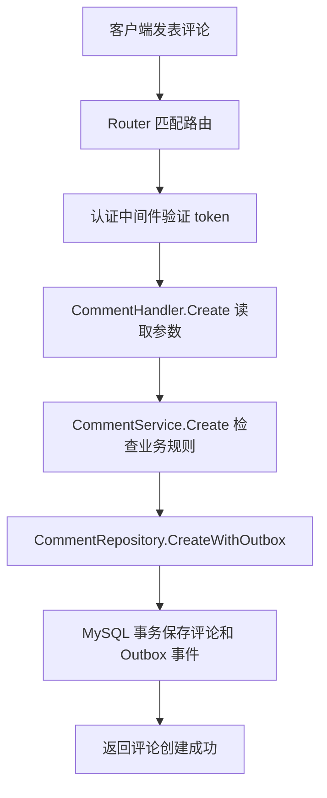
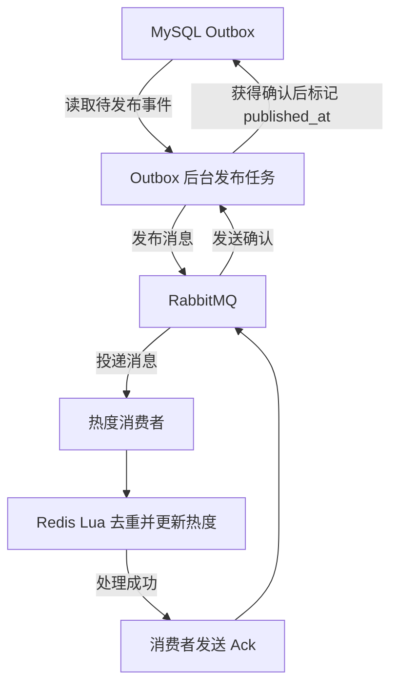

# 架构与关键流程

## 一、各层职责

`main.go` 初始化 MySQL、Redis、RabbitMQ，创建 Repository、Service 和 Handler，并把依赖连接起来。

| 模块 | 职责 |
|---|---|
| Router | 将请求方法和路径映射到处理器 |
| Middleware | 验证登录凭证，保存当前请求的身份信息 |
| Handler | 读取请求参数，调用 Service，返回 HTTP 响应 |
| Service | 组织业务检查和操作流程 |
| Repository | 访问 MySQL、Redis，执行数据库事务 |
| Queue | RabbitMQ 连接和消息发布、消费相关逻辑 |

构造函数在初始化时接收并保存依赖。例如，Service 保存 Repository，供后续处理请求时调用。

## 二、发表评论的请求流程

三个业务参数的来源：

| 参数 | 来源 |
|---|---|
| `userID` | 中间件验证后的 token |
| `videoID` | URL 中的视频 ID |
| `content` | 请求体中的评论内容 |

Service 检查视频是否存在、评论内容是否为空，然后准备评论记录和热度事件。

Repository 使用同一个 MySQL 事务保存两条记录：

- 评论保存成功、事件保存成功：提交事务。
- 任一步骤返回错误：回滚事务。

因此，成功提交的评论会同时带有待发布的热度事件。

## 三、热度事件的后台流程

主要代码对应关系：

| 步骤 | 方法或位置 |
|---|---|
| 保存评论和事件 | `CommentRepository.CreateWithOutbox` |
| 分批处理待发布事件 | `HotScoreOutboxService.PublishPending` |
| 查询待发布记录 | `HotScoreOutboxRepository.ListPending` |
| 发布消息并等待发送确认 | `queue.PublishHotScore` |
| 标记已发布 | `HotScoreOutboxRepository.MarkPublished` |
| 接收、重试和确认消息 | `main.go` 中的消费者循环 |
| 更新累计榜 | `HotVideoRepository.IncrementScoreOnce` |
| 记录窗口热度事件 | `HotVideoRepository.RecordWindowEventOnce` |

`published_at` 有值，表示发布任务已获得 RabbitMQ 发送确认，并保存了发布状态。

它不表示 Redis 已经完成热度更新。消费者处理完成后，才发送消费确认 Ack。

## 四、为什么需要事件 ID？

同一个业务事件重试、补发或重新投递时，必须保留相同的 `EventID`。

例如：

1. Redis 已经加分。
2. RabbitMQ 尚未收到消费确认，连接断开。
3. 恢复后，同一事件再次投递。
4. Redis 根据事件 ID 识别重复事件，跳过重复加分。

累计榜目前把去重记录保存 7 天。

不同的成功评论会生成不同的事件 ID，因此可以分别产生热度贡献。

## 五、常见故障如何处理？

| 情况 | 当前处理方式 |
|---|---|
| 保存评论或 Outbox 失败 | MySQL 事务回滚，接口返回错误 |
| RabbitMQ 暂时不可用 | 未发布的 Outbox 记录保留，后台后续继续尝试 |
| 消息发送成功，但发布状态标记失败 | 可能再次发布，保留原事件 ID 供消费者去重 |
| Redis 更新失败 | 消费者重试，多次失败后拒绝消息 |
| 配置了死信策略，消息被拒绝且不重新入队 | 转入死信队列 |
| Redis 更新成功，但消费确认丢失 | 消息可能再次到达，通过事件 ID 去重 |

已经标记为已发布的 Outbox 记录，不会因消息进入死信队列而自动变回待发布。

死信消息需要另外排查和处理。

## 六、关注 Feed 与热门 Feed

### 关注 Feed

1. 从 token 中取得当前用户 ID。
2. 查询当前用户关注的用户 ID 列表。
3. 从 MySQL 查询这些用户发布的视频。
4. 按 `created_at DESC, id DESC` 排序。
5. 使用上一页最后一条视频的位置生成下一页游标。

它依据关注关系查询视频。

### 热门 Feed

1. 优先读取 Redis 中缓存好的热门视频列表。
2. 缓存未命中时，通过 singleflight 合并同一进程内相同条件的并发查询。
3. 从 Redis 窗口榜取得视频 ID。
4. 到 MySQL 批量查询详情。
5. 按 Redis 的排名顺序重新排列视频。
6. 缓存组装好的结果，有效期为 5 秒。

窗口榜不可用时，尝试查询 MySQL 最新视频，并使用本地缓存和请求合并保护查询。

窗口榜查询正常但结果为空时，直接返回空列表。

## 七、窗口榜的统计含义

窗口榜统计最近 24 小时内热度变化事件的净贡献：

- 点赞：`+1`。
- 取消点赞：`-1`。
- 发布评论：`+3`。
- 删除评论：`-3`。

事件使用原始发生时间。过期事件通过后台分批清理撤销贡献，因此清理可能存在短暂滞后。

窗口榜反映窗口内事件的净变化，与当前仍然存在的点赞、评论总数含义不同。

## 八、当前实现边界

- singleflight 和降级本地缓存只在单个 Go 进程内共享。
- 累计榜去重记录有 7 天有效期，无法提供永久去重保证。
- Redis AOF 使用 everysec 策略，异常退出时可能丢失最近尚未落盘的写入。
- 尚未实现 Redis 数据全部丢失后的自动热榜重建。
- 当前关注 Feed 使用游标翻页，没有提供跨页固定数据快照。
- `/healthz` 检查 HTTP 服务响应，不逐项检查所有依赖。
- 浏览器演示页面通过同源 fetch 调用 Gin API；实际视频文件上传和转码尚未实现。
